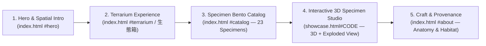

# 素樞 SKELIO — Website Architecture & Design System
**Minimalist Futuristic Specimen Experience (Apple Product-Page Inspired)**

---

## 1. Overall Site Structure & Page Flow

SKELIO transforms from two disconnected views (`index.html` light paper cover and `showcase.html` dark forest HUD) into a single cohesive, Apple-inspired spatial product narrative (`apple.com/airpods-pro` / `apple.com/vision-pro` aesthetic). The site treats each beetle specimen and the terrarium (生態箱) as precision-engineered natural artifacts presented on an ultra-clean gallery stage.

### 1.1 Information Architecture & Route Map

### 1.2 Page-by-Page Flow

1. **Landing & Hero Stage (`index.html` — `#hero`)**
   - ** Sticky Top Glass Navbar:** Translucent frosted bar (`backdrop-filter: blur(20px)`) with `SKELIO 素樞` wordmark on the left, section anchors (`Terrarium 生態箱`, `Specimens 標本圖鑑`, `Anatomy 結構`, `About 關於`) in the center, and a pill CTA (`Explore 3D 進入生態缸 → showcase.html`) on the right.
   - **Hero Viewport (`100vh` pinned):** Full-bleed near-white spatial canvas (`#fbfbfd`) featuring the 3D `生態箱.glb` floating at center stage with studio rim lighting, flanked by oversized, high-contrast Apple-style display typography (`素樞 SKELIO` / `Nature, Precision-Preserved.`).

2. **Terrarium Experience (`index.html` — `#terrarium`)**
   - **Scroll-to-Zoom or Click-to-Enter (`OPEN`):** Scrolling down (or clicking the minimal pill button `OPEN TERRARIUM`) smoothly dollies the Three.js camera from the exterior cover pose (`coverPos`) through the glass walls into the interior (`insidePos`).
   - **Interior Perch Inspection:** Inside the terrarium, the 3 hero tank specimens (`1000` 長頸鹿鋸鍬, `1601` 巴拉望, `HXM` 巨顎叉角鍬形蟲) sit on their perches. Floating frosted-glass callout pills (`#1000 · Prosopocoilus giraffa nishikawai`) anchor to each beetle in 3D screen space; clicking any callout transitions directly to `showcase.html#1000`.

3. **Specimen Bento Catalog (`index.html` — `#catalog`)**
   - **23-Specimen Modular Grid:** Below the 3D terrarium canvas, the page scrolls into a clean 12-column Apple Bento grid displaying all 23 specimens from `window.SKELIO.specimens` (`photos/0100.png` – `photos/2400.png`, `hexarthrius.png`).
   - **Filter Pills:** Instant client-side filtering by family/feature (`All 全部 (23)`, `3D Interactive 3D 模型 (3)`, `Lucanidae 鍬形蟲`, `Dynastinae 兜蟲`, `Cerambycidae 天牛 & 其他`).
   - **Card Structure:** High-key studio card (`#f5f5f7`) with specimen code badge (`#0601`), cutout/photo preview with subtle hover elevation, Chinese name (`蘇門答臘巨扁`), and italicized scientific name (`Dorcus titanus yasuokai`). Cards with `.model` display a `3D VIEW` badge and open `showcase.html#<CODE>`.

4. **Interactive 3D Specimen Studio (`showcase.html#<CODE>`)**
   - **Unified Gallery Stage:** Replaces the dark murky fog with a clean, futuristic studio environment (configurable light/dark studio toggle: **Studio Light `#f5f5f7`** default + **Obsidian Dark `#0a0a0c`** inspection mode).
   - **HUD & Precision Controls:**
     - **Top Bar:** `← SKELIO` back pill, specimen index counter (`01 / 03`), and mode toggles (`Orbit 環視` · `Explode 結構拆解` · `Studio Dark/Light`).
     - **Bottom-Left Spec Sheet:** Animated typography stack with catalog code (`#1601`), binomial name (`Dorcus titanus palawanicus`), Chinese title (`巴拉望巨扁`), and key morphological tags.
     - **Bottom-Right Switcher:** Tactile pill selector for jumping between specimens (`長頸鹿鋸鍬`, `巴拉望`, `巨顎叉角鍬形蟲`) plus a drawer trigger to browse all 23 photo specimens.

5. **About / Craft & Provenance Section (`index.html` — `#about`)**
   - **Editorial Spec Breakdown:** Two-column Apple-style specification table detailing preservation craft, 3D photogrammetry / AI reconstruction pipeline (4K/8K PBR textures, segmented anatomy), and natural habitat notes (`photos/habitat.jpg`).

---

## 2. Visual Design System

All design tokens live in a single shared stylesheet (`skelio.css`) imported by both `index.html` and `showcase.html` so both pages share one unmistakable visual language.

### 2.1 Color Palette (Minimalist Futuristic)

| Token | Hex / Value | Usage |
| :--- | :--- | :--- |
| `--bg-primary` | `#fbfbfd` | Primary page & studio canvas background (Apple alabaster white) |
| `--bg-elevated` | `#f5f5f7` | Bento specimen cards, secondary section surfaces |
| `--bg-glass` | `rgba(255, 255, 255, 0.72)` | Sticky navbar, floating HUD pills, specimen callout cards (`backdrop-filter: blur(20px) saturate(180%)`) |
| `--bg-obsidian` | `#0a0a0c` | Optional dark inspection mode in `showcase.html` & high-contrast footer |
| `--ink-primary` | `#1d1d1f` | Primary headings, specimen Chinese names, active controls |
| `--ink-secondary` | `#6e6e73` | Scientific Latin names, body copy, secondary labels |
| `--ink-tertiary` | `#86868b` | Specimen codes (`#0601`), axis ticks, disabled states, hints |
| `--accent-bio` | `#2e5a44` | Futuristic botanical emerald — active pills, 3D badges, focus rings |
| `--accent-amber` | `#b88646` | Warm specimen amber — highlight accents, hover micro-indicators |
| `--border-hairline` | `rgba(29, 29, 31, 0.08)` | `1px` crisp card borders, HUD dividers, grid lines |

### 2.2 Typography

- **Font Stack:**
  - **Display & English UI / Codes:** `'Inter', -apple-system, BlinkMacSystemFont, 'SF Pro Display', sans-serif` (replaces decorative medieval `Cinzel` with clean geometric precision; optional `'JetBrains Mono'` for `#0601` catalog codes and telemetry).
  - **Traditional Chinese Display & Editorial:** `'Noto Serif TC', 'Songti TC', serif` (retains scholarly specimen authority for Chinese names) paired with `'Noto Sans TC', 'PingFang TC', sans-serif` for UI controls and specs.
- **Type Scale & Weight Hierarchy:**
  - **Hero Display (`--text-hero`):** `clamp(2.75rem, 6vw, 5.25rem)`, weight `600`, letter-spacing `-0.03em`, line-height `1.06`.
  - **Section Headline (`--text-h1`):** `clamp(2rem, 4vw, 3.25rem)`, weight `600`, letter-spacing `-0.02em`, line-height `1.12`.
  - **Specimen Title (`--text-specimen`):** `clamp(1.5rem, 2.8vw, 2.5rem)`, weight `700` (`Noto Serif TC`), letter-spacing `-0.01em`.
  - **Scientific Name (`--text-latin`):** `clamp(0.95rem, 1.3vw, 1.15rem)`, weight `400`, italic, color `--ink-secondary`.
  - **Telemetry / Code Tag (`--text-mono`):** `0.75rem` (`12px`), weight `500`, uppercase, letter-spacing `0.18em`, tabular-nums (`font-variant-numeric: tabular-nums`).

### 2.3 Spacing & Layout Grid

- **Container & Max Width:** `max-width: 1280px` centered with responsive horizontal padding `clamp(24px, 5vw, 64px)`.
- **Grid System:** 12-column CSS Grid (`gap: 20px` on desktop, `12px` on mobile).
  - **Featured 3D Specimen Cards (Tank 3):** Span 4 columns each (`grid-column: span 4`) in the top row of the catalog.
  - **Standard Specimen Cards:** Span 3 columns (`grid-column: span 3`, 4 per row on desktop; 2 per row on tablet; 1 per row on mobile).
- **Radius & Elevation:**
  - Cards: `border-radius: 24px`, border `1px solid var(--border-hairline)`, resting shadow `0 4px 24px rgba(0, 0, 0, 0.03)`.
  - Floating HUD Pills: `border-radius: 999px`, padding `10px 20px`.
- **8px Spatial Scale:** `--space-1: 4px`, `--space-2: 8px`, `--space-3: 16px`, `--space-4: 24px`, `--space-5: 32px`, `--space-6: 48px`, `--space-7: 80px`, `--space-8: 120px`.

---

## 3. Interaction Design

### 3.1 Page Transitions & Camera Continuity
- **Seamless Cross-Page Transition:** Clicking a specimen in `index.html` (or clicking `← SKELIO` in `showcase.html`) triggers a `350ms` frosted-glass crossfade (`document.startViewTransition` where supported, with CSS opacity fallback) and passes the specimen code via URL hash (`showcase.html#1601`).
- **Camera Handoff:** Both pages use matching easing (`cubic-bezier(0.22, 1, 0.36, 1)` in CSS; cubic ease-out / smoothstep in Three.js) so the camera dolly-in on `index.html` (`1700ms`) and the studio intro dolly on `showcase.html` (`2400ms`) feel like one continuous lens movement.

### 3.2 Scroll-Driven Animations
- **Hero-to-Terrarium Scroll Scrubbing (`index.html`):**
  - Scrolling through the first `180vh` scrubs the parameter `u ∈ [0, 1]` driving `camNow.lerpVectors(coverPos, insidePos, e)` (or users can click `OPEN` to auto-animate `u` from `0 → 1`).
  - As `u` passes `0.75`, the 3D beetle perches fade in and 2D screen-space HUD pins (`THREE.Vector3.project(camera)`) lock onto each specimen.
- **Section Reveal Choreography:** Bento cards and spec rows use `IntersectionObserver` to reveal with subtle vertical lift (`translateY(16px) → translateY(0)`, `opacity: 0 → 1`, staggered by `40ms`). All animations respect `@media (prefers-reduced-motion: reduce)`.

### 3.3 Hover & Pointer States
- **Bento Cards:** Hovering lifts the card by `translateY(-4px)` over `320ms cubic-bezier(0.22, 1, 0.36, 1)`, deepens shadow to `0 16px 40px rgba(0, 0, 0, 0.07)`, and scales the specimen image by `1.035`.
- **3D Raycast Hover (`index.html` & `showcase.html`):** Moving the pointer over a 3D beetle in the terrarium highlights its floating label pill and changes the cursor to `pointer`; dragging on empty canvas uses `grab` / `grabbing`.
- **Exploded View Slider (`showcase.html`):** When a segmented model has multiple child meshes (`group.children`), an interactive `Explode 結構拆解` range slider (`0% – 100%`) radially offsets each part along its outward normal vector from the specimen centroid (`part.position.lerpVectors(restPos, explodedPos, explodeFactor)`).

### 3.4 Loading & Error States
- **Unified Progress Pill:** Replaces the raw text `LOADING 1 / 3` with a sleek frosted pill containing a thin animated progress bar (`0% → 100%`), specimen name, and numeric counter (`Loading 1 / 3 · 長頸鹿鋸鍬`).
- **Graceful Fallback:** If a `.glb` model fails to load (e.g., opened via `file://` or missing asset), the `.catch()` handler displays a clean glass notification pill (`模型載入失敗 · 請以 Live Server 開啟或切換至 2D 圖鑑`) and automatically displays the high-resolution specimen photo (`spec.photo`) so the page never appears broken.

---

## 4. Three.js 3D Content Integration

### 4.1 Keeping the Existing Scene & Data Architecture Intact
- **`specimens.js` as Single Source of Truth:** Retains `window.SKELIO.specimens` (all 23 entries, including the corrected `0601` `Dorcus titanus yasuokai`) and `window.SKELIO.tank` (`1000`, `1601`, `HXM`). Optional metadata fields (`lengthMm`, `origin`, `family`) can be appended non-destructively.
- **`index.html` (`生態箱.glb` + 3 Tank Beetles):**
  - Keeps the existing `loadGLB('生態箱.glb')`, `fitCreature()`, `placeBeetles()`, `perches`, and `coverPos → insidePos` interpolation logic.
  - Wraps the Three.js canvas inside a sticky viewport container (`#terrarium-stage { position: sticky; top: 0; height: 100vh; }`) inside a `200vh` scroll track, allowing the user to scroll past the 3D stage into the 23-specimen Bento catalog below without losing WebGL context.
  - Adds a `THREE.Raycaster` on `pointerup` (when `!moved`) so clicking any of the 3 beetles inside the terrarium navigates to `showcase.html#<code >`.
- **`showcase.html` (3D Specimen Studio + 2D Cutout Fallback):**
  - Keeps `prepareModel()`, `seat()`, `ensure()`, `focusIndex()`, inertial orbit (`orbitY`, `orbitX`), and `punchKey()` texture cutout helper.
  - **Studio Lighting Upgrade:** Matches the clean Apple studio palette by setting the default background/fog to `#f5f5f7` (with a 1-click toggle to the original `#0c0b08` dark terrarium mood) and keeping the soft ground plane as a subtle shadow catcher.
  - **23-Specimen Support:** For the 3 specimens with `.model` (`1000`, `1601`, `HXM`), `showcase.html` loads the `.glb` 3D mesh; for the remaining 20 specimens (which have `photo: 'photos/XXXX.png'`), `showcase.html` can either display their cutout plane in 3D space via the existing `loadTexture(spec.photo)` / `punchKey()` function already written in `showcase.html` (lines 133–167) or preview them in a slide-over detail modal.

---

## 5. Prioritized Implementation Checklist

### Phase 1 — Shared Design System & Visual Unification (P1 — Do First)
- [ ] **1.1 Create `skelio.css` with shared tokens:** Extract color variables (`--bg-primary`, `--bg-glass`, `--ink-primary`, `--accent-bio`), typography rules (`Inter` + `Noto Serif TC`), frosted-glass HUD pills, and reduced-motion utilities so `index.html` and `showcase.html` look like one website.
- [ ] **1.2 Sync `main` and `terrarium` branches:** Merge the `models/`, `photos/`, and `.gitignore` assets from `terrarium` into `main` so `main` is a complete, runnable repository.
- [ ] **1.3 Add Top Glass Navigation Bar to both pages:** Unify the header (`SKELIO 素樞`, section links, and `← Atelier` / `Explore 3D` navigation) across `index.html` and `showcase.html`.
- [ ] **1.4 Unify Loading & Error UI:** Upgrade `#status` in `index.html` and `#hint` in `showcase.html` into the same frosted-glass progress pill with a visual progress bar.

### Phase 2 — Apple-Style Layout & 3D-to-Page Integration (P2 — Core UX)
- [ ] **2.1 Add the 23-Specimen Bento Catalog to `index.html`:** Convert `index.html` from `overflow: hidden` into a scroll-capable page where the 3D `生態箱.glb` stage is pinned at the top, followed by the responsive Bento grid of all 23 specimens from `SKELIO.specimens` with family filter pills.
- [ ] **2.2 Add 3D Beetle Click-Through & Floating Callouts in `index.html`:** Project 3D perch coordinates to 2D screen-space labels (`#1000`, `#1601`, `#HXM`) once `phase === 'inside'`, and wire clicks to `showcase.html#<code>`.
- [ ] **2.3 Activate Photo Cutout Planes in `showcase.html` for Non-GLB Specimens:** Wire the existing `loadTexture()` / `punchKey()` function in `showcase.html` so any of the 20 photo-only specimens clicked from the catalog renders cleanly on a 3D billboard card when `spec.model` is undefined.
- [ ] **2.4 Add Studio Light / Dark Mode Toggle in `showcase.html`:** Default `showcase.html` to the high-key Apple Studio Light palette (`#f5f5f7`) for visual continuity with `index.html`, with a header toggle to switch to the dramatic dark habitat view (`#0c0b08`).

### Phase 3 — Futuristic Polish & Micro-Interactions (P3 — Next-Level Detail)
- [ ] **3.1 Interactive Exploded View (`Explode 結構拆解`) in `showcase.html`:** Add a HUD slider that checks if a loaded `.glb` contains segmented sub-meshes (from Tripo Segmentation) and smoothly translates each part outward from its bounding-box center on scrub.
- [ ] **3.2 Scroll-Linked Camera Dolly on `index.html`:** Allow mouse-wheel / trackpad scroll to smoothly scrub the `coverPos → insidePos` camera transition in addition to the `OPEN` button.
- [ ] **3.3 Scale Bar & Specimen Telemetry Overlay:** Add subtle millimeter scale ticks and specimen metadata (`Origin`, `Family`, `Catalog ID`) to the `showcase.html` HUD.
