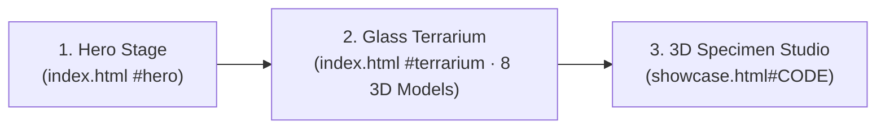

# 素樞 SKELIO — Website Architecture & Design System

**Minimalist Futuristic 3D Specimen Gallery (Apple Product-Page Inspired · 3D-Model-Only)**

---

## 1. Site Structure & Page Flow

SKELIO unifies the light terrarium cover (`index.html`) and the 3D specimen viewer (`showcase.html`) into a single spatial narrative inspired by Apple product pages (`apple.com/airpods-pro`, `apple.com/vision-pro`). Every creature and the glass terrarium (`生態箱.glb`) are presented purely as 3D `.glb` artifacts (no 2D photo catalog or cutout textures).

### 1.1 Route & Section Flow

### 1.2 Section Architecture

| View / Route | Role | Core Elements & User Actions |
| :--- | :--- | :--- |
| **1. Hero Stage** `index.html` (`phase === 'cover'`) | Spatial introduction | Full-viewport alabaster canvas (`#f6f5f2`) with floating glass terrarium (`生態箱.glb`), studio rim lighting, `SKELIO` wordmark, and `OPEN` call-to-action. |
| **2. Glass Terrarium** `index.html` (`phase === 'inside'`) | Interior habitat exploration | Clicking `OPEN` (or canvas) transitions camera from `coverPos` (`32°` FOV) into `insidePos` (`48°` FOV). Inside, the 8 `SKELIO.tank` 3D `.glb` models (`1000` 長頸鹿鋸鍬, `1601` 巴拉望, `HXM` 巨顎叉角鍬形蟲, `0800` 戰神大兜, `1500` 兔子尤犀金龜, 傑森暴龍, 巨人柱, 蠍子) rest on automatically detected habitat surfaces (`collectSeats()` / `sitOn()`) with drag-look (`yaw`/`pitch`) and scroll-wheel zoom (`0.26×–1.65×`). |
| **3. 3D Specimen Studio** `showcase.html#CODE` / `?id=CODE` | Close-up 3D inspection | Obsidian dark habitat stage (`#0c0b08`); top bar (`← ATELIER`, `01 / 08` counter); bottom-left spec sheet (`#CODE`, Latin binomial, Chinese name); bottom-right 8-model switcher (`#dots`), inertial orbit drag, wheel/arrow navigation, and background next-model preloading. |

---

## 2. Visual Design System

### 2.1 Color Palette

| Token | Value | Application |
| :--- | :--- | :--- |
| `--paper` / `--bg-primary` | `#f6f5f2` / `#fbfbfd` | Primary terrarium cover background |
| `--ink` / `--ink-primary` | `#1c1b18` / `#1d1d1f` | Primary headings, Chinese specimen names, active controls |
| `--ink-deep` / `--bg-obsidian` | `#0c0b08` | Dark inspection stage in `showcase.html` |
| `--stone` | `#e7e2d8` | Light foreground typography in `showcase.html` |
| `--moss` | `#67755c` | Italicized Latin binomials and botanical accents |
| `--amber` | `#a9793f` | Specimen catalog codes (`#1000`) and hover highlights |

### 2.2 Typography Scale

- **UI & Latin Display:** `'Cinzel', serif` for codes, counters, and HUD status hints.
- **Traditional Chinese Display:** `'Noto Serif TC', serif` for specimen titles and navigation picks.

---

## 3. Interaction & Fault-Tolerance Design

| Interaction / Guard | Trigger | Motion & Resilience Behavior |
| :--- | :--- | :--- |
| **Terrarium Entry** | `#open` click or canvas tap | `1700ms` smoothstep (`u²(3 - 2u)`) camera interpolation from `coverPos` (`32°` FOV) to `insidePos` (`48°` FOV) while background shifts from `#f6f5f2` to `#e7e3da`. |
| **Interior Look & Zoom** | Pointer drag & scroll wheel in `phase === 'inside'` | Inertial first-person look (`lookFromEye()`, `yaw` damping `0.92`, `pitch` clamped to `[-0.35, 0.28]`) and wheel zoom scaling distance from `focus` within `[0.26, 1.65]`. |
| **Boot & CDN Guards** | Missing `window.THREE`, `GLTFLoader`, `WebGLRenderer`, or `window.SKELIO` | Validates dependencies before `boot()` runs and surfaces clear Chinese diagnostics (`3D 程式庫載入失敗` / `標本資料載入失敗`). |
| **`file://` Protocol Guard** | Opening HTML directly via `file:` | Immediately warns `請以 Live Server 開啟，否則無法載入模型`, and appends `· 請以 Live Server 開啟` if GLB loading fails under `file:`. |
| **WebGL & Context Recovery** | `new THREE.WebGLRenderer` exception or `webglcontextlost` | Wraps renderer creation in `try/catch` (`此瀏覽器不支援 WebGL`) and handles `webglcontextlost` / `webglcontextrestored` (`顯示中斷`) without crashing the animation loop. |
| **Batch & Cached GLB Loading** | `placeBeetles()` (`index.html`) & `ensure()` (`showcase.html`) | `index.html` uses `Promise.allSettled` with an accurate `++loaded` counter (`LOADING 1 / 8`, or `已載入 X / 8` on partial failure). `showcase.html` caches in-flight promises (`inflight[i]`) and verifies `active === index` to prevent duplicate 60 MB downloads and race conditions. |

All animations respect `@media (prefers-reduced-motion: reduce)` by snapping directly to target states and disabling continuous idle motion.

---

## 4. Three.js Content Integration (3D Models Only)

1. **`specimens.js` (Single 3D Model Registry):**
   - Defines the 8 3D `.glb` models in `window.SKELIO.specimens` and `window.SKELIO.tank`:
     - `1000` — 長頸鹿鋸鍬 (`Prosopocoilus giraffa nishikawai`, `models/長頸鹿.glb`)
     - `1601` — 巴拉望 (`Dorcus titanus palawanicus`, `models/巴拉望.glb`)
     - `HXM` — 巨顎叉角鍬形蟲 (`Hexarthrius mandibularis`, `models/巨顎叉角.glb`)
     - `0800` — 戰神大兜 (`Megasoma mars`, `models/戰神大兜.glb`)
     - `1500` — 兔子尤犀金龜 (`Eupatorus birmanicus`, `models/兔子.glb`)
     - 傑森暴龍 (`models/傑森暴龍.glb`)
     - 巨人柱 (`models/巨人柱.glb`)
     - 蠍子 (`models/蠍子.glb`)
2. **`index.html` (Glass Terrarium Stage):**
   - Loads `models/生態箱.glb`, applies automatic glass-panel detection (`panelLike()` with `glassMat`), detects interior habitat seating (`collectSeats()` + `sitOn()`), and loads all 8 tank `.glb` models via `Promise.allSettled`.
3. **`showcase.html` (3D Specimen Studio):**
   - Loads each specimen's `.glb` model on demand with in-flight promise caching (`ensure()`), supports `#CODE` (`location.hash`), `?id=CODE` / `?code=CODE` (`URLSearchParams`), and `hashchange` navigation, and gracefully handles specimens with or without `code` / `latin` metadata.
