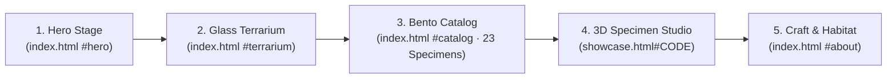

# 素樞 SKELIO — Website Architecture & Design System

**Minimalist Futuristic Specimen Gallery (Apple Product-Page Inspired)**

---

## 1. Site Structure & Page Flow

SKELIO unifies the light terrarium cover (`index.html`) and the 3D specimen viewer (`showcase.html`) into a single spatial narrative inspired by Apple product pages (`apple.com/airpods-pro`, `apple.com/vision-pro`). Each beetle specimen and the glass terrarium (`生態箱.glb`) are presented as precision-preserved natural artifacts on a high-key studio stage.

### 1.1 Route & Section Flow

### 1.2 Section Architecture

| View / Route | Role | Core Elements & User Actions |
| :--- | :--- | :--- |
| **1. Hero Stage** `index.html#hero` | Spatial introduction | Sticky frosted-glass navbar (`SKELIO 素樞`, section links, `Explore 3D` CTA); `100vh` alabaster canvas (`#fbfbfd`) with floating `生態箱.glb`, studio rim lighting, and display headline (`素樞 SKELIO`). |
| **2. Glass Terrarium** `index.html#terrarium` | Interior habitat exploration | Clicking `OPEN` (or canvas) transitions camera from `coverPos` (`32°` FOV) into `insidePos` (`48°` FOV). Inside, the 3 `SKELIO.tank` beetles (`1000` 長頸鹿鋸鍬, `1601` 巴拉望, `HXM` 巨顎叉角鍬形蟲) rest on perches with drag-look (`yaw`/`pitch`), scroll-wheel zoom (`0.26×–1.65×`), and 2D callout pills linking to `showcase.html#CODE`. |
| **3. Specimen Bento Catalog** `index.html#catalog` | Full collection browser | 12-column Apple Bento grid presenting all 23 entries in `window.SKELIO.specimens` (`photos/0100.png`–`photos/2400.png`, `hexarthrius.png`). Instant filter pills (`All 全部`, `3D Models 3D 模型`, `Lucanidae 鍬形蟲`, `Dynastinae 兜蟲`, `Cerambycidae 天牛 & 其他`). |
| **4. 3D Specimen Studio** `showcase.html#CODE` | Close-up 3D & anatomy inspection | Studio Light (`#f5f5f7`) / Obsidian Dark (`#0a0a0c`) stage; top bar (`← SKELIO`, `01 / 03` counter, `Orbit 環視` · `Explode 結構拆解` toggles); bottom-left spec sheet (`#CODE`, Latin binomial, Chinese name); bottom-right specimen switcher. |
| **5. Craft & Provenance** `index.html#about` | Editorial specification | Two-column specification layout covering specimen preservation, 4K/8K PBR scan & segmentation workflow, and natural habitat imagery (`photos/habitat.jpg`). |

---

## 2. Visual Design System

All tokens live in a shared `skelio.css` imported by both `index.html` and `showcase.html`.

### 2.1 Color Palette

| Token | Value | Application |
| :--- | :--- | :--- |
| `--bg-primary` | `#fbfbfd` | Primary page and default 3D studio background (Apple alabaster) |
| `--bg-elevated` | `#f5f5f7` | Bento specimen cards and secondary content surfaces |
| `--bg-glass` | `rgba(255, 255, 255, 0.72)` | Navbar, HUD pills, and callouts (`backdrop-filter: blur(20px) saturate(180%)`) |
| `--bg-obsidian` | `#0a0a0c` | Dark inspection mode in `showcase.html` and footer surface |
| `--ink-primary` | `#1d1d1f` | Primary headings, Chinese specimen names, active controls |
| `--ink-secondary` | `#6e6e73` | Italicized Latin binomials, body copy, secondary labels |
| `--ink-tertiary` | `#86868b` | Catalog codes (`#0601`), scale ticks, muted HUD hints |
| `--accent-bio` | `#2e5a44` | Botanical emerald for active pills, `3D` badges, and focus rings |
| `--accent-amber` | `#b88646` | Warm specimen amber for hover indicators and code highlights |
| `--border-hairline` | `rgba(29, 29, 31, 0.08)` | `1px` card borders, HUD dividers, and spec table rules |

### 2.2 Typography Scale

- **UI & Latin Display:** `'Inter', -apple-system, BlinkMacSystemFont, 'SF Pro Display', sans-serif` (replaces `Cinzel` for clean technical precision; `'JetBrains Mono'` optional for `#0601` codes).
- **Traditional Chinese Display:** `'Noto Serif TC', 'Songti TC', serif` for specimen titles, paired with `'Noto Sans TC', 'PingFang TC', sans-serif` for UI labels.

| Token | Size (`clamp`) | Weight | Tracking / Line Height | Usage |
| :--- | :--- | :--- | :--- | :--- |
| `--text-hero` | `clamp(2.75rem, 6vw, 5.25rem)` | `600` | `-0.03em` / `1.06` | Hero headline (`素樞 SKELIO`) |
| `--text-h1` | `clamp(2rem, 4vw, 3.25rem)` | `600` | `-0.02em` / `1.12` | Section headers (`#catalog`, `#about`) |
| `--text-specimen` | `clamp(1.5rem, 2.8vw, 2.5rem)` | `700` | `-0.01em` / `1.20` | Specimen Chinese name (`Noto Serif TC`) |
| `--text-latin` | `clamp(0.95rem, 1.3vw, 1.15rem)` | `400` (italic) | `0em` / `1.45` | Scientific name (`Dorcus titanus yasuokai`) |
| `--text-mono` | `0.75rem` (`12px`) | `500` | `0.18em` / `1.00` | Catalog codes (`#0601`), counters (`tabular-nums`) |

### 2.3 Layout Grid & Spatial Tokens

- **Container:** `max-width: 1280px`, centered, horizontal padding `clamp(24px, 5vw, 64px)`.
- **12-Column Bento Grid:** `gap: 20px` desktop / `12px` mobile.
  - **Featured 3D Tank Specimens (`1000`, `1601`, `HXM`):** `grid-column: span 4` (3 across on desktop).
  - **Standard Photo Specimens (20 items):** `grid-column: span 3` (4 across desktop, 2 tablet, 1 mobile).
- **Surfaces & Radii:** Cards use `border-radius: 24px`, `1px solid var(--border-hairline)`, and resting shadow `0 4px 24px rgba(0, 0, 0, 0.03)`. Floating HUD pills use `border-radius: 999px` and `padding: 10px 20px`.
- **8px Spacing Scale:** `--space-1: 4px`, `--space-2: 8px`, `--space-3: 16px`, `--space-4: 24px`, `--space-5: 32px`, `--space-6: 48px`, `--space-7: 80px`, `--space-8: 120px`.

---

## 3. Interaction Design

| Interaction | Trigger | Motion & Visual Behavior |
| :--- | :--- | :--- |
| **Page Transition** | Clicking a specimen card or `← SKELIO` | `350ms` crossfade (`document.startViewTransition` with opacity fallback) passing `#CODE` in the URL hash (`showcase.html#1601`). |
| **Terrarium Entry** | `#open` click, canvas tap, or scroll scrub | `1700ms` smoothstep (`u²(3 - 2u)`) camera interpolation from `coverPos` (`32°` FOV) to `insidePos` (`48°` FOV) while background shifts from `#f6f5f2` to `#e7e3da`. |
| **Interior Look & Zoom** | Pointer drag & scroll wheel in `phase === 'inside'` | Inertial first-person look (`lookFromEye()`, `yaw` damping `0.92`, `pitch` clamped to `[-0.35, 0.28]`) and wheel zoom scaling distance from `focus` within `[0.26, 1.65]`. |
| **Bento Card Hover** | Pointer hover on `#catalog` card | Card lifts `translateY(-4px)` over `320ms cubic-bezier(0.22, 1, 0.36, 1)`, shadow deepens to `0 16px 40px rgba(0, 0, 0, 0.07)`, specimen photo scales to `1.035`. |
| **Exploded View (`結構拆解`)** | Range slider (`0%–100%`) in `showcase.html` | Offsets segmented `.glb` child meshes radially from the model centroid: `part.position.lerpVectors(restPos, explodedPos, factor)`. |
| **Loading & Fallback** | GLB fetch progress / `.catch()` error | Frosted progress pill (`Loading 1 / 3 · 長頸鹿鋸鍬`). On load failure, displays a glass notice (`載入失敗 · 請以 Live Server 開啟`) and falls back to `spec.photo`. |

All animations respect `@media (prefers-reduced-motion: reduce)` by snapping directly to target states and disabling continuous idle motion.

---

## 4. Three.js Content Integration

1. **`specimens.js` (Single Data Source):**
   - Preserves `window.SKELIO.specimens` (23 specimens, including `0601` `Dorcus titanus yasuokai` and `2200` `Dorcus alcides`), `window.SKELIO.habitat`, and `window.SKELIO.tank` (`1000`, `1601`, `HXM`). Optional metadata (`lengthMm`, `origin`, `family`) can be added per entry without breaking existing consumers.
2. **`index.html` (Glass Terrarium + Scrollable Catalog):**
   - Retains `loadGLB('生態箱.glb')`, automatic glass-panel detection (`panelLike()` applying transparent `glassMat` with `opacity: 0.16`, `renderOrder: 2`), `fitCreature()` with `polygonOffset`, `placeBeetles()`, `lookFromEye()`, and wheel zoom.
   - Places the WebGL canvas inside a sticky viewport stage (`#terrarium-stage { position: sticky; top: 0; height: 100vh; }`) above the `#catalog` and `#about` DOM sections so users can transition from the 3D terrarium into the 23-specimen Bento grid on a single page.
   - Adds `THREE.Raycaster` hit-testing on perched beetles (`!moved` on `pointerup`) and 2D screen-space callout pills (`THREE.Vector3.project(camera)`) to jump to `showcase.html#CODE`.
3. **`showcase.html` (3D Specimen Studio + 2D Cutout Fallback):**
   - Retains `prepareModel()`, `seat()`, `ensure()`, `focusIndex()`, inertial orbit (`orbitY`, `orbitX`), and `punchKey()` background keying.
   - Defaults to the high-key Studio Light environment (`#f5f5f7`) for visual continuity with `index.html`, with a toggle for the original dark habitat mood (`#0c0b08`).
   - Uses `.glb` meshes for the 3 tank specimens and activates the existing `loadTexture(spec.photo)` + `punchKey()` pipeline to render 3D cutout planes for the remaining 20 photo-only specimens.

---

## 5. Prioritized Implementation Checklist

### Phase 1 — Shared Design System & Branch Unification (P1)
- [x] **1.0 Glass terrarium & scroll-wheel zoom (`terrarium` branch `0d6a82a`):** Upgraded `生態箱.glb` with `panelLike()` glass material, `32° → 48°` FOV entry, and `0.26×–1.65×` wheel zoom.
- [ ] **1.1 Create shared `skelio.css`:** Extract color, typography (`Inter` + `Noto Serif TC`), frosted-glass pill, and reduced-motion tokens shared by `index.html` and `showcase.html`.
- [ ] **1.2 Sync `terrarium` into `main`:** Merge `models/`, `photos/`, `.gitignore`, and the glass terrarium `index.html` from `terrarium` into `main`.
- [ ] **1.3 Unified top glass navbar & loading pill:** Add the shared translucent header and progress-bar status pill to both pages.

### Phase 2 — Apple Bento Catalog & Cross-Scene Navigation (P2)
- [ ] **2.1 Build 23-specimen Bento grid on `index.html`:** Pin the 3D terrarium stage at the top and render all 23 `SKELIO.specimens` cards below with family/3D filter pills.
- [ ] **2.2 Add 3D beetle callout pins & click-through:** Project perch coordinates to 2D pills in `phase === 'inside'` and navigate to `showcase.html#CODE` on click.
- [ ] **2.3 Enable 2D cutout planes in `showcase.html`:** Connect `loadTexture()` / `punchKey()` when `spec.model` is absent so all 23 specimens can be inspected in `showcase.html`.
- [ ] **2.4 Add Studio Light / Dark theme toggle in `showcase.html`:** Default to `#f5f5f7` studio lighting with a one-click switch to `#0c0b08` dark mode.

### Phase 3 — Advanced 3D Polish (P3)
- [ ] **3.1 Exploded-view slider (`Explode 結構拆解`):** Add radial part separation in `showcase.html` for multi-part segmented `.glb` models.
- [ ] **3.2 Scroll-scrubbed terrarium entry:** Allow vertical scroll position to scrub the `coverPos → insidePos` transition on `index.html`.
- [ ] **3.3 Telemetry & millimeter scale overlay:** Add subtle scale ticks and provenance metadata to the `showcase.html` HUD.
